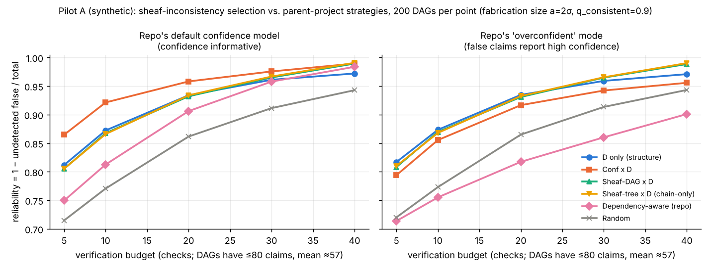

# Pilot A: sheaf-Laplacian inconsistency for budgeted verification on claim DAGs

**Status: preliminary pilot on a simulator. No LLM was queried.** The "model outputs" are synthetic vectors generated from an explicit assumption (below). What the pilot can show is how a sheaf-style score *interacts with the parent project's budget metric*. It cannot show whether real LLM outputs behave like the assumption.

Links: [catalog avenues S2 / O1](../../02_avenues_catalog.md#s2) · [design #2](../../03_experiment_designs.md) · [primer §13](../../05_category_theory_primer.md)

## Question

Will's `delta_comp` compares two routes along a *chain*. In a claim **DAG** a claim can have several parents, so there are more routes that should agree. Two sub-questions:

1. Does a sheaf inconsistency score using **all DAG edges** localise false claims better than the same score restricted to the **spanning tree** (the chain-only analogue of `delta_comp`)?
2. Used as `p_false` in the parent project's `p_false · D` rule, does it raise **reliability at a fixed budget** compared with her strategies, a pure-structure baseline (`D` only), and confidence?

## Method

* DAGs, truths, confidences and descendant counts come **unchanged from `dag_codes/dag_model.ClaimDAG`**, with the PARC-fitted rates from `dag_codes/constants.py` (base error 0.1758, propagation 0.9262), at most 80 claims, and 15% extra-parent probability. The evaluation is the repo's own `evaluate()`: a caught false claim quarantines its descendants, and reliability = 1 − undetected false / total. The budget is 20 checks, the parent project's headline, plus a sweep from 5 to 40.
* **Sheaf.** Each claim has an 8-dimensional "content" stalk. Each edge `u→v` has restriction maps `R_e` (orthogonal) and `I`. The true contents form a global section: `R_e x*_u = x*_v` on every edge, cross edges included.
* **Observation model (the key assumption).** A true claim reports `x*_v + σ·noise`. An *originating* error (all parents true) reports `x*_v + a·(random direction)`, a "fabrication" of size `a·√d`. A *propagated* error, with probability `q_consistent`, reasons consistently from its false parent (`x_v = R_e x_p + σ·noise`) and otherwise fabricates. This builds in the "consistently wrong" failure mode the project paper worries about.
* **Score (gold-free).** The repair score is `ΔE(v) = E_v(x_v) − min_y E_v(y)`, where `E_v` is the Dirichlet energy `Σ ||R_e x_u − x_v||²` of the edges at `v`. It measures how much total inconsistency drops if only `v` is re-solved (a local harmonic-extension step). It is turned into a pseudo-probability with a robust noise scale and multiplied by `D = 1 + descendants`.
* Strategies: Random; the repo's Uncertainty and Dependency-aware; `D` only; `Conf × D`; `Sheaf-tree × D` (tree edges only, i.e. chain-only); `Sheaf-DAG × D`; `Sheaf-DAG + Conf × D`; an "edge → upstream endpoint" rule; naive incident energy × D; and a truth-conditioned greedy ceiling.
* Grid: fabrication size `a ∈ {0.5,1,2,4}σ`, `q_consistent ∈ {0.5,0.9,0.99}`, extra-edge probability `{0,0.15,0.4}`. Each runs under the repo's **default** confidence model and its **`overconfident`** mode, where false claims report *high* confidence. 200 DAGs per cell, with paired bootstrap CIs over DAGs.

## Results (all numbers from [`results/summary.md`](results/summary.md))



1. **Structure dominates the budget metric.** At budget 20 with base settings (a=2σ, q=0.9), `Sheaf-DAG × D` gets 0.932 against 0.934 for `D` only (difference −0.002, CI [−0.006, +0.002]). In this simulator most of the reliability comes from catching the roots of large false cascades, and descendant count alone does most of that.
2. **The sheaf score helps only when fabrications are large or the budget is large.** At a=4σ it beats `D` only by +0.009 [+0.006, +0.012] (default confidence) and +0.007 [+0.005, +0.011] (overconfident). At budget 40 in the overconfident mode it reaches 0.988, against 0.971 for `D` only and 0.956 for `Conf × D`. At small fabrications (a ≤ 1σ) it is *worse* than `D` only (e.g. −0.021 [−0.027, −0.016] at a=0.5σ).
3. **Confidence wins when it is informative; the sheaf score wins when it is not.** With the repo's default (informative) confidence model, `Conf × D` (0.958) beats every sheaf variant. In the overconfident mode, confidence is anti-informative (node AUROC 0.34), and `Sheaf-DAG × D` beats `Conf × D` by +0.014 [+0.008, +0.020] at a=2σ. It also beats the repo's dependency-aware rule by +0.113 [+0.095, +0.131]. That is the parent project's research question 2 (a structural signal the model cannot misreport), here answered *in simulation only*.
4. **Using DAG cross edges instead of tree edges did not matter for the budget.** `Sheaf-DAG × D − Sheaf-tree × D` lies within ±0.003 in every cell. At the node level, cross edges do expose some consistently-wrong claims: AUROC for "propagated, consistent" errors rises from 0.229 (tree) to 0.279 (DAG) at p=0.15, and from 0.336 to 0.425 at p=0.4. That is not enough to change which 20 claims get checked.
5. **Consistently-wrong claims are invisible to consistency. Worse, they rank *below* true claims.** Node AUROC of the sheaf score at a=2σ is 0.67 for originating errors but **0.28 for consistently-propagated errors** (pooled over all false claims, 0.42). Inconsistency lives on the *boundary* of a false region: the edge from a true parent into the first false claim, and edges from false parents to true children. The interior of a consistent false cascade has low energy. Re-solving the false root alone can even *raise* energy, because its consistent false children now disagree with it. Blaming the upstream endpoint of high-energy edges did not fix this (0.923 vs 0.932).

## Caveats

* Everything rests on the observation model. With real LLMs one would need (i) real restriction maps, i.e. what an answer to sub-question A implies for sub-question B, and (ii) empirical rates of consistent vs fresh error propagation. Will's MuSiQue runs (`will/project1`) already contain the material to estimate (ii) on chains.
* Strategies are static (choose all checks up front). An adaptive policy that re-scores after each check could exploit boundary information better: after catching a false boundary node, move inward.
* The repo's `overconfident` mode makes confidence anti-informative (AUROC 0.34), which is extreme. Real verbalised confidence was near chance (0.48–0.60) in Will's paper.

## Reproduce

```bash
# from the repo root; ~1 min on 4 CPU cores
pip install numpy scipy networkx scikit-learn matplotlib
python3 will/ct_safety_survey/pilots/sheaf_dag/sheaf_dag_pilot.py --trials 200
python3 will/ct_safety_survey/pilots/sheaf_dag/summarize.py
python3 will/ct_safety_survey/pilots/sheaf_dag/make_figure.py
```
The script imports `dag_codes/` directly; `--quick` runs 10 DAGs per cell. Seeds are fixed (DAG seed = trial index; observation seed = 10000 + trial).
