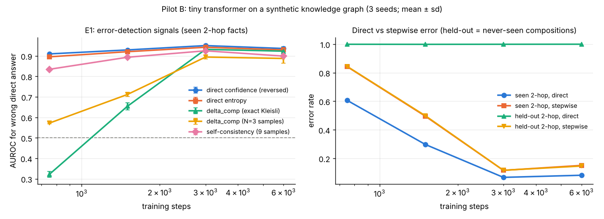

# Pilot B: functoriality, duality and linear-relational tests in a tiny transformer

**Status: preliminary pilot on a toy.** A 2-layer, 128-dim transformer is trained from scratch on a synthetic knowledge graph (CPU, ~10 min per seed, 3 seeds). There are **no pretrained LLMs**: Hugging Face was unreachable from the sandbox. A toy gives two things API models cannot: gold answers for every query, and **exact** answer distributions, so the Kleisli composite is computed exactly, without sampling. It is *not* evidence about real LLMs.

Links: [catalog A1/A2/A5/A7 (functoriality), D1/D2 (dagger), A9 (linear functor)](../../02_avenues_catalog.md) · [designs 1, 4, 5](../../03_experiment_designs.md) · [primer §9 Markov categories, §4 dagger](../../05_category_theory_primer.md)

## Setup

- **World.**
  - 1000 entities and 6 relations. Each relation is a random **bijection**, so it has an inverse `r⁻¹`.
  - Entity popularity is Zipf(1), and training facts are sampled in proportion to it. Rare entities are learned late, a crude stand-in for long-tail hallucination.
- **Query format.** A query is 3 tokens `[e, r1, r2]` (`r2 = NOOP` for one hop). The model outputs a distribution over entities.
- **Training pool.**
  - all 6000 one-hop facts;
  - inverse facts for a random **half** of the (e, r) pairs;
  - 30% of all (e, r1, r2) two-hop facts.
- **Training.** AdamW, lr 1e-3, batch 512, 6000 steps. Checkpoints at 750, 1500, 3000 and 6000 steps stand in for "weak → strong" models.
- **E1 functoriality (Will's test, exact).**
  - `P_direct = model(e, r1, r2)`.
  - `P_step(z) = Σ_y P(y | e, r1) · P(z | y, r2)`: the exact composite in the Kleisli category of the distribution monad.
  - `delta_comp = TV(P_direct, P_step)`.
  - Also the sampled estimator Will uses (N = 3 or 10 per route), and self-consistency from 3N samples.
  - Labels: is the direct answer wrong? Evaluated on 6000 **seen** two-hop facts (in the training pool, possibly imperfectly memorised) and 3000 **held-out** two-hop facts (never seen as composites).
  - H1 analogue: 5-fold out-of-fold logistic regression, with a baseline of direct confidence, direct entropy, hop-1 and hop-2 confidence, then adding `delta_comp`. Bootstrap CIs are per seed.
- **E2 dagger (reversal).**
  - Accuracy of `r⁻¹` queries on pairs never trained in reverse.
  - Round-trip score `ρ = Σ_t P(t | e, r) P(e | t, r⁻¹)` as a gold-free signal for forward errors.
- **E3 linear-relational functor.** Each relation is a ridge-regressed affine map on entity embeddings (unembedding rows, or input embeddings), in the spirit of Hernandez et al.'s LREs. Question: is `A_{r2} A_{r1} ≈ A_{r1 r2}`?

## Results (mean ± sd over 3 seeds; every number is from [`results/summary.md`](results/summary.md))



*Right panel: the two stepwise curves overlap, because the stepwise route never uses two-hop training.*

**E1 — the functoriality signal depends on the stepwise route being competent.**
- Early in training (750 steps; one-hop accuracy 0.39) the direct route is better than the stepwise one (direct error 0.61 vs stepwise 0.84). There, exact `delta_comp` is an **anti-signal**: AUROC 0.32 ± 0.02 for "direct answer wrong", because disagreement mostly flags stepwise errors.
- Once one-hop recall is good (3000 steps; one-hop accuracy 0.94), the signal is strong. Exact `delta_comp` reaches AUROC 0.93 ± 0.01 and adds **+0.028 to +0.051** AUROC over the confidence/entropy/hop-confidence baseline (all per-seed CIs exclude 0 at 3000 and 6000 steps).
- Will's practical estimator (N = 3 samples per route) adds **+0.019 to +0.035** over the baseline *plus* 9-sample self-consistency at 3000–6000 steps. At 750 steps it adds about 0.
- So in this toy the composition signal **grows** with competence. That is the opposite of Will's MuSiQue pattern (stronger for gpt-4.1-mini than gpt-5.5). One reading consistent with both: the signal needs a reliable stepwise route, and it is largest when direct and stepwise errors are *independent*. Whether that holds for a given LLM is an empirical question.
- Caveat: here the model's own softmax confidence is already an excellent detector (AUROC 0.91–0.95). Real LLMs' *verbalised* confidence was near chance in Will's paper, so the relative value of `delta_comp` could be larger there.

**E1 — sampled vs exact.** The N = 3 estimator is noisier than the exact composite once the model is competent (0.895 vs 0.932 AUROC at 3000 steps). It is *less* bad when the model is weak (0.57 vs 0.32 at 750 steps), because sampling noise dilutes the anti-signal. Going from N = 3 to N = 10 recovers most of the gap (0.919). This supports computing the stepwise distribution as a proper Kleisli mixture (avenue A2).

**E1b — consistent-but-wrong does not occur in this toy.**
- Among seen two-hop queries whose routes agree (TV < 0.1: 34% of queries at 3000 steps, 44% at 6000), the error rate is **0.000** at every checkpoint.
- In this world, errors are independent memorisation failures, so two wrong routes almost never agree on the same wrong entity. That differs from real LLMs: Will's scale300 runs have 13–20 questions wrong with both routes agreeing, and pilot A *assumes* consistent propagation.
- A toy that is to say anything about the blind spot (Design 5) must plant systematic false beliefs.

**E1c — no compositional generalisation.**
- On never-seen compositions the direct route is wrong 99.9–100% of the time at every checkpoint. The stepwise route is right as often as on seen ones (stepwise error 0.12 at 3000 steps).
- So `delta_comp` is near 1 everywhere (0.98 at 3000 steps) and detection is trivial. This is consistent with the literature on failures of latent two-hop composition (`balesni2024twohop`). We did not try the much longer training that out-of-distribution composition might need.

**E2 — the reversal curse, and the dagger check as a detector.**
- Reverse queries on pairs never trained in reverse: accuracy **0.000–0.001** (chance 0.001). On reverse-trained pairs: 0.94 at 3000 steps. The toy reproduces the reversal curse (`berglund2024reversal`): the model's "functor" does not preserve the converse.
- Where the converse *was* learned, 1 − round-trip is a useful forward-error signal. It adds **+0.017 to +0.051** AUROC over forward confidence + entropy (all 12 seed × checkpoint CIs exclude 0).
- Where it was not learned, the round-trip is ≈0 everywhere (mean 0.001) and the score is an anti-signal (AUROC 0.26–0.44).
- **The dagger test only works for facts the model holds in both directions.** That limits Design 4 to relations with naturally co-occurring converses.

**E3 — linear-relational functoriality: uninformative null.**
- Ridge-fit linear maps do not represent single relations at all: one-hop nearest-neighbour faithfulness 0.000–0.004, at chance 0.001.
- So the composition defect (1.10–1.14) is indistinguishable from the mismatched-pair null (1.13–1.14).
- This is expected: the relations are *random permutations* with no geometric regularity, whereas Hernandez et al.'s LREs work on real relations. **Nothing about real LLMs follows.** The test needs a pretrained LM (small question #16).

## Caveats

- A toy with random relations, 3 tokens and no language. Confidence is softmax probability, not verbalised.
- Three seeds. One seed (seed 1) shows a late training instability: one-hop accuracy drops from 0.944 to 0.890 between steps 3000 and 6000.
- The H1 CIs bootstrap over queries within a seed. They do not capture seed-to-seed variation, which the ± sd columns do.

## Reproduce

```bash
pip install -r requirements.txt           # torch (CPU is fine), numpy, scikit-learn, matplotlib
for s in 0 1 2; do python3 kg_pilot.py --seeds $s --threads 1 & done; wait   # ~10 min on 4 cores
python3 summarize.py                       # -> results/summary.md, results/kg_auroc_by_checkpoint.png
python3 kg_pilot.py --quick                # 1 seed, 800 steps, smoke test (~2 min)
```
Run from this folder. No downloads are needed. Seeds fix the world, the training data order and the samplers.
